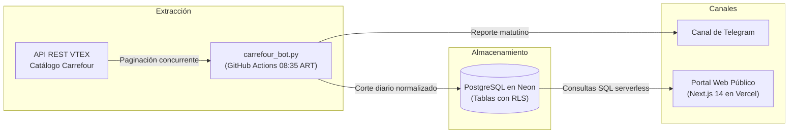

# Carrefour Monitor de Precios

> Sistema automatizado de relevamiento diario de precios en Carrefour Argentina para medir la variación interdiaria y la inflación mensual acumulada mediante una canasta familiar ponderada.

[](https://github.com/SoySid/carrefour-bot/actions/workflows/carrefour.yml)
[](https://carrefour-bot-web.vercel.app)
[](https://t.me/carrefour_monitor_bot)

---

## Componentes del Proyecto

- **Motor de Relevamiento:** [`carrefour_bot.py`](./carrefour_bot.py) — Consulta concurrente sobre la API VTEX de Carrefour, filtrado de anomalías, cálculo de la canasta ponderada y despacho de reportes.
- **Portal Web:** [`web/`](./web) — Interfaz de consulta y seguimiento de series históricas construida con Next.js 14, Tailwind CSS y driver `@neondatabase/serverless`.
- **Automatización Diaria:** [`.github/workflows/carrefour.yml`](./.github/workflows/carrefour.yml) — Tarea programada que ejecuta el relevamiento todas las mañanas a las 08:35 ART (11:35 UTC).
- **Seguridad y Persistencia:** [`scripts/hardening_db.sql`](./scripts/hardening_db.sql) — Configuración de Row Level Security (RLS) y aislamiento de roles para PostgreSQL en Neon.

---

## Arquitectura del Sistema



---

## Metodología de Medición

A diferencia de un promedio simple de productos sueltos, donde rubros con miles de artículos secundarios distorsionan el total, el índice utiliza criterios de canasta cerrada:

1. **Venta directa y stock real**: Solo se computan productos comercializados directamente por Carrefour (`sellerId = 1`) con disponibilidad efectiva para compra, ignorando publicaciones de terceros del marketplace.
2. **Ponderación por rubro**: Cada departamento aporta al índice general según su peso en el consumo habitual de un hogar:

| Rubro | Ponderación | Cobertura |
| :--- | :---: | :--- |
| **Carnes y pescados** | 22% | Cortes vacunos, pollo, cerdo y pescadería fresca |
| **Almacén** | 20% | Aceites, pastas, harinas, arroz, legumbres y conservas |
| **Lácteos y productos frescos** | 15% | Leches, quesos, mantecas y yogures |
| **Frutas y verduras** | 10% | Frutas y hortalizas frescas de estación |
| **Panadería** | 8% | Panificados frescos y de molde |
| **Desayuno y merienda** | 8% | Café, té, yerba, galletitas y cereales |
| **Bebidas** | 6% | Aguas, jugos, gaseosas e infusiones |
| **Limpieza** | 6% | Lavandinas, detergentes y jabón para ropa |
| **Perfumería y farmacia** | 3% | Cuidado e higiene personal diaria |
| **Congelados** | 2% | Verduras y alimentos congelados preparados |

> [!NOTE]
> **Filtros de integridad**: Se excluyen subcategorías no esenciales de supermercado (bazar, cestos, mopas, perfumería fina, maquillaje y ortopedia) y se descartan precios mayores a $100.000 o saltos diarios extremos provocados por equivocaciones tipográficas temporales en la plataforma.

---

<details>
<summary><b>Formato de Alerta Diaria en Telegram</b></summary>

```text
📊 Reporte Carrefour - 2026-10-19

🛒 CANASTA FAMILIAR PONDERADA
• Día: +0.00% ➖ (🔺0 🔻0 ➖11,187)
• Acumulado Mes (Octubre): +2.83% 📈

📋 Variación por Rubro (Ponderación IPC):
🏷️ Almacén (20%): +0.00% ⚪ (Mes: +3.90%)
🏷️ Desayuno y merienda (8%): +0.00% ⚪ (Mes: +2.85%)
🏷️ Bebidas (6%): +0.00% ⚪ (Mes: +1.96%)
🏷️ Lácteos y productos frescos (15%): +0.00% ⚪ (Mes: +3.36%)
🏷️ Carnes y pescados (22%): +0.00% ⚪ (Mes: +1.03%)
🏷️ Frutas y verduras (10%): +0.00% ⚪ (Mes: +3.48%)
🏷️ Panadería (8%): +0.00% ⚪ (Mes: +2.36%)
🏷️ Congelados (2%): +0.00% ⚪ (Mes: +3.13%)
🏷️ Limpieza (6%): +0.00% ⚪ (Mes: +3.89%)
🏷️ Perfumería y farmacia (3%): +0.00% ⚪ (Mes: +4.77%)
```

</details>
